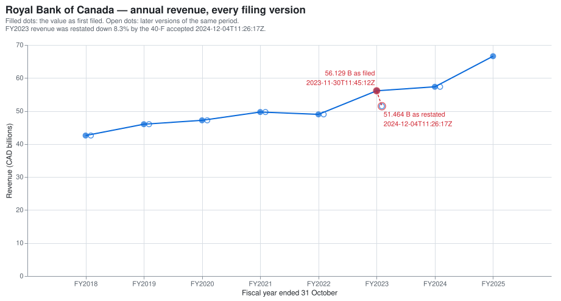

# edgar-pit

edgar-pit builds a research-grade, point-in-time fundamentals dataset from the SEC's free APIs. Every value is keyed by the moment its filing was accepted, every restatement is kept as a new version, and every 8-K item is an event with an exact timestamp — so `asof('RY', 'revenue', '2024-01-15')` returns what an investor could actually have known that day. It covers US GAAP and IFRS filers, including Canadian companies cross-listed in the US.



The 51.464 B CAD figure was not knowable before 2024-12-04T11:26:17Z: it appears only in the 40-F that the SEC accepted at that second. A query dated one second earlier returns the 56.129 B CAD that the 2023 40-F reported, and the database keeps both versions with their accession numbers.

## Why point-in-time

- **Period end** (`2023-10-31`) says when the fiscal year ended, not when anyone could see its numbers.
- **Filing date** (`2023-11-30`) is the day EDGAR assigned the filing; anything accepted after the cutoff is dated the next day.
- **Acceptance time** (`2023-11-30T11:45:12Z`) is the second EDGAR accepted the filing — the earliest moment its numbers were public.
- A backtest that selects on period end or filing date can use a number hours or days before it existed; `edgar-pit` compares `acceptance_ts` and nothing else.
- `period_end`, `filed`, `filing_date`, `fy` and `fp` never decide what was known, in the pipeline or in any query.

SEC's submissions JSON currently mis-states `acceptanceDateTime` for many filings, and the error runs in both directions, so trusting it can be lookahead. This project reads each filing's SGML header `<ACCEPTANCE-DATETIME>` instead and keeps the API value only for QA. A filing with no header gets a conservative upper bound (`filing_date` 23:59:59 New York, raised to at least the API value plus six hours) flagged `ts_imputed`.

## Quick start (offline, no SEC credentials)

Everything below runs from a fresh clone against the bundled fixtures, with no network:

```bash
uv sync --frozen
uv run edgarpit build --offline --fixtures tests/fixtures/sec --out /tmp/ep
uv run edgarpit asof --db /tmp/ep/edgarpit.duckdb --ticker RY --field revenue --asof 2024-01-15T00:00:00Z --json
```

```json
[{"cik": "0001000275", "ticker": "RY", "field": "revenue", "asof": "2024-01-15T00:00:00Z", "period": "FY", "value": 56129000000.0, "unit": "CAD", "currency": "CAD", "period_start": "2022-11-01", "period_end": "2023-10-31", "period_type": "FY", "accession": "0001193125-23-285639", "form": "40-F", "acceptance_ts": "2023-11-30T11:45:12Z", "version": 1, "is_restatement": false, "restatement_kind": "none", "ts_imputed": false}]
```


## Live data

Set a declared User-Agent first; SEC requires one of the form "Name email" and the client refuses to make a request without it. Copy `.env.example` to `.env` and set `SEC_USER_AGENT="Your Name you@example.com"`, then:

```bash
uv run edgarpit fetch --universe config/universe.csv --out ./data
uv run edgarpit build --data ./data --out ./build
uv run edgarpit qa --db ./build/edgarpit.duckdb
uv run edgarpit export --db ./build/edgarpit.duckdb --out ./release
```

Measured on the full universe (October 2026, one Apple silicon laptop): `fetch` downloaded 40 submissions documents, 188 paginated pages, 40 companyfacts documents and 11,647 SGML headers in **11,915 requests over 2,566.9 s (≈43 minutes)** at an average **4.64 requests/s**; a second `fetch` over the same cache made 268 requests in 85.6 s and downloaded **zero** headers, because headers are immutable. `build` took 20.3 s and produced a **30.5 MiB** DuckDB file with 429,703 filings, 17,056 8-K item rows and 821,605 raw facts, which dbt turned into **86,782 `fundamentals_pit` rows** and 18,057 `ratios_pit` rows. `qa` exited 0 (`Key uniqueness: OK`), and `export` wrote the five Parquet files plus `manifest.json`. 581 of the 11,647 headers predate XBRL and carry no acceptance time; those filings use the conservative fallback above, and their 8-K items are still read.

The client respects SEC fair access: one request at a time through a token bucket capped at 5 requests/s, exponential backoff with jitter on 429/5xx, and a User-Agent on every request. Raw responses are cached immutably under `data/raw/` with a SHA-256 manifest, so a re-fetch adds files instead of overwriting them and an interrupted run resumes warm.

## Interfaces

### Python

```python
from edgarpit.query import asof

r = asof("RY", "revenue", "2024-01-15T00:00:00Z")[0]
print(r.value, r.unit, r.period_end, r.accession, r.acceptance_ts)
```

```text
56129000000.0 CAD 2023-10-31 0001193125-23-285639 2023-11-30 11:45:12+00:00
```

`asof(identifier, field, asof_ts, period="FY", n=1)` takes a ticker or a CIK and returns the latest version of each of the `n` most recent periods accepted at or before `asof_ts`; every result carries the accession, form and acceptance time it came from. `history(identifier, field)` returns every version of every period, and `events(identifier, item=None, start=None, end=None)` returns 8-K items with their acceptance times. Timestamps must carry a timezone (`Z` or an offset); naive input is rejected.

### DuckDB SQL

```bash
duckdb /tmp/ep/edgarpit.duckdb -c "SET TimeZone='UTC'; SELECT period_end, version, value, accession, acceptance_ts, restatement_kind FROM main.fundamentals_pit WHERE ticker = 'RY' AND field = 'revenue' AND period_type = 'FY' ORDER BY period_end DESC, version LIMIT 5;"
```

```text
┌────────────┬─────────┬───────────────┬──────────────────────┬──────────────────────────┬──────────────────┐
│ period_end │ version │     value     │      accession       │      acceptance_ts       │ restatement_kind │
│    date    │  int64  │    double     │       varchar        │ timestamp with time zone │     varchar      │
├────────────┼─────────┼───────────────┼──────────────────────┼──────────────────────────┼──────────────────┤
│ 2025-10-31 │       1 │ 66605000000.0 │ 0001193125-25-305927 │ 2025-12-03 11:28:41+00   │ none             │
│ 2024-10-31 │       1 │ 57344000000.0 │ 0001193125-24-270294 │ 2024-12-04 11:26:17+00   │ none             │
│ 2024-10-31 │       2 │ 57344000000.0 │ 0001193125-25-305927 │ 2025-12-03 11:28:41+00   │ none             │
│ 2023-10-31 │       1 │ 56129000000.0 │ 0001193125-23-285639 │ 2023-11-30 11:45:12+00   │ none             │
│ 2023-10-31 │       2 │ 51464000000.0 │ 0001193125-24-270294 │ 2024-12-04 11:26:17+00   │ revision         │
└────────────┴─────────┴───────────────┴──────────────────────┴──────────────────────────┴──────────────────┘
```

### REST

```bash
EDGARPIT_DB=/tmp/ep/edgarpit.duckdb uv run uvicorn api.main:app --port 8000
curl -fsS "localhost:8000/asof?ticker=RY&field=revenue&asof=2024-01-15T00:00:00Z&period=FY"
```

```json
[{"cik":"0001000275","ticker":"RY","field":"revenue","value":56129000000.0,"unit":"CAD","currency":"CAD","period_start":"2022-11-01","period_end":"2023-10-31","period_type":"FY","accession":"0001193125-23-285639","form":"40-F","acceptance_ts":"2023-11-30T11:45:12Z","version":1,"is_restatement":false,"ts_imputed":false,"restatement_kind":"none"}]
```

`GET /asof`, `GET /history` and `GET /events` mirror the Python functions, and the OpenAPI schema is at `http://localhost:8000/docs`.

### Explorer

```bash
EDGARPIT_DB=/tmp/ep/edgarpit.duckdb uv run streamlit run explorer/app.py
```

Pick an issuer and a field to see every version on a timeline, move the as-of slider and watch later versions grey out, and browse 8-K items with links to the filing index pages. A hosted copy of the same app runs at `<explorer-url>`.

### Parquet release

```bash
uv run edgarpit export --db /tmp/ep/edgarpit.duckdb --out /tmp/ep/release
```

`export` writes `fundamentals_pit.parquet`, `ratios_pit.parquet`, `events_8k.parquet`, `filings.parquet`, `facts_raw.parquet` and a `manifest.json` with row counts, SHA-256 per file and the SEC fetch range. The Phase 1 release is attached at `<release-url>`.

## Data model

| Table | One row per | Key | Notes |
|---|---|---|---|
| `filings` | filing | `accession` | form, filing date, report date, `acceptance_ts`, `acceptance_ts_source`, `ts_imputed`, 8-K items, amendment flag |
| `events_8k` | (filing, 8-K item) | `(accession, item_code)` | item code and label, acceptance time |
| `facts_raw` | companyfacts entry | `(cik, taxonomy, concept, unit, period_start, period_end, accession)` | as reported, before concept mapping |
| `fundamentals_pit` | (issuer, field, period, filing) | `(cik, field, period_start, period_end, accession)` | canonical field, value, unit, currency, source concept, `version`, `is_restatement`, `restatement_kind` |
| `ratios_pit` | (issuer, ratio, period, `asof_ts`) | `(cik, ratio, period_start, period_end, asof_ts)` | ROE, leverage, net margin; inputs share currency and unit and were all accepted at or before `asof_ts` |

Full column contracts, the staging schema and the query semantics are in [`docs/architecture.md`](docs/architecture.md).

## Coverage and limitations

- **Universe:** 40 issuers, 20 Canadian and 20 US, a mix of 40-F and 10-K filers resolved from submissions data rather than hard-coded.
- **Fields:** 20 canonical fundamentals fields (revenue, gross profit, operating income, net income, income before tax, basic and diluted EPS, R&D, operating cash flow, capex, total assets, current assets, cash, inventory, accounts receivable, total liabilities, current liabilities, long-term debt, total equity, shares outstanding) mapped to `us-gaap` and `ifrs-full` concepts in [`config/concept_map.yaml`](config/concept_map.yaml), with per-taxonomy rank lists.
- **As reported:** values are not FX-converted, so a CAD filer's row carries CAD and a US filer's USD; ratios refuse to combine different currencies or unit families. There is no derived Q4: XBRL reports annual and year-to-date periods, and YTD periods are kept as `OTHER` and excluded from `asof`.
- **Restatements:** `is_restatement` is a change greater than 0.5 % from the first version. `restatement_kind` separates `split_adjustment` (a share-based value re-reported for a near-integer split factor within 0.5 %) from `revision`; the tolerance is a heuristic, so a split with an unusual factor or drifting per-share values is reported as a revision (Apple's FY2019 diluted EPS, 2.46 → 0.61, is a 4.03× change and classifies as a revision).
- **8-K items before 2004-08-23** use an older item-numbering scheme; QA counts those events per issuer and their labels are unreliable.
- **Coverage gaps are reported, not hidden.** In the live build BNS has 10 of the 20 fields (banks tag no gross profit, operating income or inventory), and JPM's `long_term_debt` stops at FY2013 while its `cash` starts at FY2015 because the concepts it uses changed. `edgarpit qa` prints per-issuer coverage (fields × fiscal years), the largest unmapped concepts (4,901 in the live build), 7 unit/currency anomalies, and ratio gaps by reason (1,882 YTD periods excluded by design, 1,089 periods with a missing ratio input, 1 zero denominator).

## How it is tested

- Classic point-in-time bugs have named tests that fail when the rule breaks: `tests/test_query_asof.py::test_restatement_accepted_after_asof_is_not_returned`, `tests/test_query_asof.py::test_period_end_before_asof_but_filed_after_is_excluded`, `tests/test_query_asof.py::test_property_no_row_after_asof` (Hypothesis, random as-of timestamps), `tests/test_ratios.py::test_mixed_currency_ratio_is_rejected`, `tests/test_companyfacts.py::test_ifrs_and_usgaap_map_to_same_canonical_field`, and the dbt test `transform/tests/assert_ratio_inputs_not_from_future.sql`.
- The end-to-end module drives the installed CLI through `subprocess` over the fixture cache and pins the RY restatement boundary, the `qa` exit codes, the API and the explorer.
- CI runs `lint`, `types`, `tests` and `dbt` on every pull request. Tests never touch the network: HTTP is mocked with `respx`, and live checks are marked `network` and excluded. The suite is 462 tests; the two `network` tests are deselected by default.
- Two independent builds of the same fixtures produce byte-identical Parquet files and manifests that are equal after removing `build_timestamp`.

## Licence and data

MIT — see [LICENSE](LICENSE). The data comes from SEC EDGAR, which publishes it as public records; this project is not affiliated with or endorsed by the SEC. Every request declares a User-Agent and stays at or below 5 requests per second.
